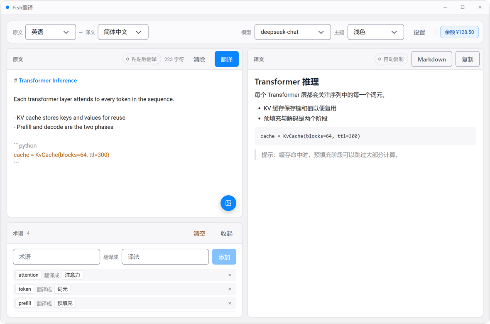
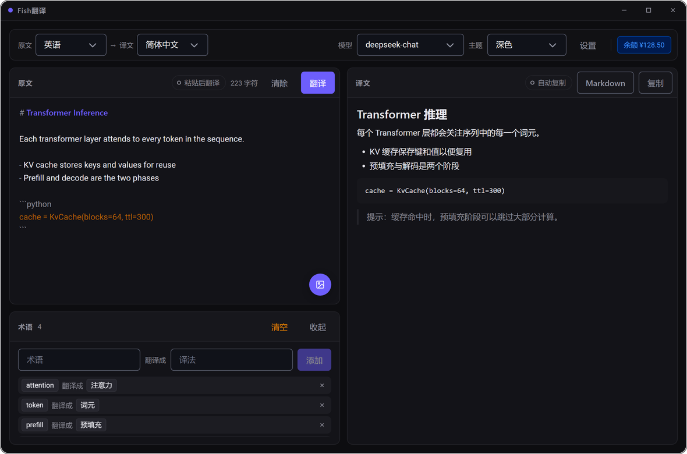
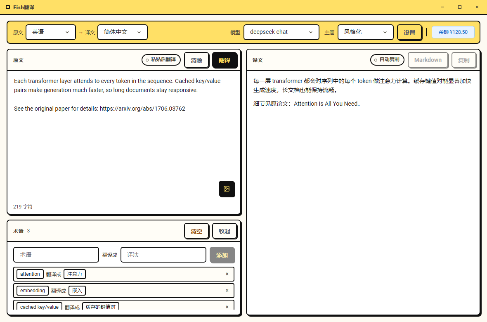
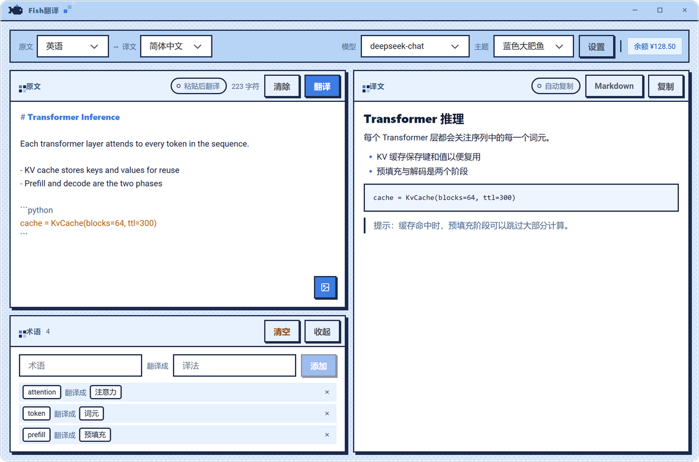

# Fish翻译


> **自用小工具，需要者自取：[下载](https://github.com/jrfeng/FishTranslate/releases)**

> **本项目完全由 AI 编码完成。**
>
> 代码、界面、图标、构建脚本、CI 流水线与文档，全部在 [DeepSeek Harness](https://deepseek-harness.github.io/deepseek-harness/en/guide/quickstart) 的会话中由 AI 代理生成与迭代，没有手写代码。
> 人类负责提出需求、挑选设计、决定发布节奏，并对每个版本做实际运行验收。

一款面向开发者的多语言翻译工具，内置 14 种常用语言、可自由指定原文与译文语言。针对技术文本做了结构整理：把原文重排为 Markdown 再翻译，保留代码、命令、路径等术语的原始形态，输出可直接粘贴进文档。

翻译、图片识别、余额查询全部在本机发起，API Key 只保存在本机，不经过任何中间服务器。

---

## 界面

| 浅色 | 深色 |
|:---:|:---:|
|  |  |

**风格化**（2px 黑描边、硬阴影、黄黑配色）



**蓝色大肥鱼**（像素风、直角硬边、点阵背景、手绘像素鲸鱼与插画水印）



> 截图使用模拟数据展示界面，不代表真实接口返回。

---

## 功能特性

### 翻译

- 双栏布局：左侧原文输入、右侧译文输出，译文以 Markdown 渲染，可切换回源码视图
- **语言对可选**：原文 / 译文各自从 14 种语言里挑（简体中文、英语、日语、韩语、法语、德语、西班牙语、俄语、葡萄牙语、意大利语、阿拉伯语、越南语、泰国语、印尼语），默认英语 → 简体中文，选择会记住
- 原文与译文选成同一种语言时，点「翻译」会弹提示并**不发请求**
- 两侧都带 Markdown 语法高亮（标题、列表、引用、代码块、链接）
- 支持「粘贴后翻译」：粘贴即自动翻译；也可 `Ctrl/Cmd + Enter` 手动触发
- 相同文本 + 相同术语 + 相同模型 + 相同语言对不会重复请求，避免浪费额度
- 修改原文、术语、模型或语言后，旧译文标记为「需重新翻译」

### 术语表

- 三段式添加：`术语` → `翻译成` → `译法`，逐条生效于后续翻译
- 条目内原文与译文分别用浅色小块区分，可单条删除
- 一键清空（二次确认），配置随应用持久化

### 图片翻译

- 支持粘贴截图或从本地选择图片，调用 DeepSeek OCR 接口识别文字后填入输入框
- 识别完成可对同一张图片「刷新」重识别，识别中图标旋转并显示实时耗时
- 识别结果可在「校验」弹窗中核对：上半部分图片支持滚轮缩放、拖拽平移、双击还原，下半部分文本支持 预览 / 编辑 切换，确认后才写回输入框

### 界面

- 四套内置主题：浅色、深色、风格化、蓝色大肥鱼（像素风），另有「跟随系统」实时跟随系统深浅色
- 自定义无边框窗口与标题栏，与主题配色统一；macOS 使用系统原生红绿灯
- **Toast、确认弹窗、校验弹窗全部跟随主题**：描边粗细、圆角、投影、字体都取自当前主题令牌
- 「校验」弹窗把图片区做成内嵌屏幕（主题底色 + 描边），文本区直接坐在弹窗底上
- 余额标签点击可刷新，刷新期间下方显示扫光进度（最短 1 秒）；余额不可用时连左侧分隔线一起隐藏
- 设置面板底部有「关闭」按钮，不用再点一次工具栏的「设置」
- 输出区顶部有细扫光进度指示，替代传统进度条
- 未配置 API Key 时，「设置」按钮显示小红点提示

### 可靠性

- 所有错误提示均为中文，按官方错误码映射，不暴露英文原文
- 错误通过 Toast（自动消失）+ 行内状态双通道提示；提醒类提示用主题强调色的左侧色条区分
- 点「翻译」时若未填 API Key，展开设置面板并弹一条提醒
- 单实例运行：重复启动只会唤起已有窗口
- Rust 侧 panic 与前端异常均会落盘 / 在界面提示，便于排查

---

## 快速开始

### 首次配置

打开应用 → 点击「设置」→ 填写 API Key 与接口地址（默认 `https://api.deepseek.com`）→ 点击「保存并读取模型」。

模型列表来自 `/models`，读取成功后出现在顶部下拉框中。

---

## 接口依赖

| 能力 | 接口 | 说明 |
|---|---|---|
| 翻译 | `POST /chat/completions` | OpenAI 兼容格式，兼容第三方服务 |
| 模型列表 | `GET /models` | 用于填充模型下拉框 |
| 余额 | `GET /user/balance` | DeepSeek 专有；接口地址不是官方域名时自动关闭 |
| 图片 OCR | `POST /v1/tools/ocr` | DeepSeek 专有，`multipart/form-data`，按页计费 |

**接口地址不是 DeepSeek 官方域名时，图片翻译与余额显示会整体关闭**（图片按钮隐藏、粘贴拦截、调用兜底、余额条隐藏），因为 OCR 与余额接口只在 DeepSeek 官方提供。翻译与模型列表不受影响。

---

## 构建

### 环境要求

| 平台 | 依赖 |
|---|---|
| Windows | Node.js、Rust（stable，`x86_64-pc-windows-msvc`）、MSVC Build Tools、Windows SDK |
| macOS | Node.js、Rust、Xcode Command Line Tools（`xcode-select --install`） |
| Linux | Node.js、Rust、WebKitGTK 4.1 开发包、OpenSSL 头文件（详见下方） |

前端使用 **Web Awesome + esbuild** 打包，构建分两步：

```bash
npm install          # 安装 Web Awesome、esbuild、Tauri CLI
npm run build        # esbuild 把 src/ 打包成 dist/
```

### Windows

```powershell
# 只出 exe（需先执行 npm run build）
cd src-tauri
cargo build --release

# 出 exe + NSIS 安装包（自动执行 npm run build）
npx tauri build
```

安装包输出到 `src-tauri/target/release/bundle/nsis/`。首次构建会下载 NSIS，需要联网。所有平台的成品统一收进仓库根目录的 `build/`（已被 git 忽略）。

一键脚本：`build-win.cmd`（正式版）、`debug\build-win-debug.cmd`（debug 版）。

### macOS

```bash
chmod +x build-macos.sh
./build-macos.sh
```

| 参数 | 作用 |
|---|---|
| （无） | 构建当前架构（Apple Silicon → arm64，Intel → x86_64） |
| `--universal` | 同时支持 Intel + Apple Silicon（体积翻倍） |
| `--app-only` | 只生成 `.app`，跳过 `.dmg` |
| `--help` | 显示用法 |

产物位于 `src-tauri/target/release/bundle/macos/` 与 `.../dmg/`（`.dmg` 会复制一份到 `build/`）。macOS 专属打包配置在 `src-tauri/tauri.macos.conf.json`，Tauri 仅在 macOS 构建时合并。

窗口外观按平台区分：macOS 保留**系统原生红绿灯**（配置为 `decorations: true` + `titleBarStyle: "Overlay"` + `hiddenTitle`，标题栏透明、内容延伸到顶部），Windows / Linux 使用无边框窗口加自绘标题栏。前端通过 `html[data-platform]` 切换对应布局。

未签名应用首次打开会被 Gatekeeper 拦截：右键 →「打开」，或执行

```bash
xattr -dr com.apple.quarantine "/Applications/Fish翻译.app"
```

### Linux

需要 WebKitGTK 4.1 开发包（Tauri 2 的硬性依赖）与 OpenSSL 头文件（Rust 侧 TLS 使用系统 OpenSSL）。

Debian / Ubuntu：

```bash
sudo apt install -y libwebkit2gtk-4.1-dev build-essential curl wget file \
  libxdo-dev libssl-dev libayatana-appindicator3-dev librsvg2-dev patchelf
```

Fedora：

```bash
sudo dnf install webkit2gtk4.1-devel openssl-devel libappindicator-gtk3-devel \
  librsvg2-devel patchelf
```

Arch：

```bash
sudo pacman -S webkit2gtk-4.1 base-devel openssl libappindicator-gtk3 librsvg patchelf
```

```bash
chmod +x build-linux.sh
./build-linux.sh
```

| 参数 | 作用 |
|---|---|
| （无） | 构建 `.deb` 与 `.AppImage` |
| `--deb` | 只构建 `.deb` |
| `--appimage` | 只构建 `.AppImage` |
| `--help` | 显示用法 |

产物位于 `src-tauri/target/release/bundle/deb/` 与 `.../appimage/`，脚本会自动复制一份到 `build/`：

| 产物 | 体积 | 说明 |
|---|---|---|
| `Fish翻译_<版本>_amd64.deb` | 约 2.9 MB | 依赖 `libwebkit2gtk-4.1-0`、`libgtk-3-0`，安装到 `/usr/bin/fish-translate`；deb 包名仍是 `fish-translate` |
| `Fish翻译_<版本>_amd64.AppImage` | 约 80 MB | 内置 WebKitGTK 运行时，免安装，体积大是正常的 |

```bash
# 安装 deb
sudo dpkg -i src-tauri/target/release/bundle/deb/*.deb

# 运行 AppImage
chmod +x src-tauri/target/release/bundle/appimage/*.AppImage
```

**构建 AppImage 的额外说明**

`.AppImage` 打包时 Tauri 会调用 `linuxdeploy`（本身也是 AppImage 格式），需要 FUSE 2。脚本会检测 `libfuse.so.2`：缺失时自动切到 `APPIMAGE_EXTRACT_AND_RUN=1` 的解压执行模式，因此最小化系统 / 容器 / WSL 里也能出包。

另外首次打包需要联网下载 `AppRun`、`linuxdeploy` 等辅助工具（来自 GitHub Releases），网络受限时会报下载失败。

**中文字体（必装）**

界面是中文的，Linux 最小安装 / WSL 默认没有任何中日韩字体，中文会显示成方块。装一个即可：

```bash
sudo apt install -y fonts-noto-cjk
```

没有 sudo 权限时，也可以只装到用户目录：

```bash
apt-get download fonts-noto-cjk
dpkg -x fonts-noto-cjk*.deb /tmp/fonts
mkdir -p ~/.local/share/fonts
cp /tmp/fonts/usr/share/fonts/opentype/noto/*.ttc ~/.local/share/fonts/
fc-cache -f
```

应用字体栈已包含 `Noto Sans CJK SC`、`Noto Sans SC`、`PingFang SC`、`WenQuanYi Micro Hei` 等，装好字体后无需额外配置。

> 单实例依赖桌面会话的 DBus，在纯 SSH 或无桌面环境下可能不生效。

**已验证环境**：Ubuntu 22.04.5（WSL 2 + WSLg），`.deb` 与 `.AppImage` 均可产出，程序在 WSLg 下能正常启动。

### 开发流程

项目遵循「先测试版、后正式版」：

1. 运行 `debug\build-win-debug.cmd`：构建 debug 版并安装到 `%LOCALAPPDATA%\Programs\FishTranslateTest\`，先验证效果
2. 确认无误后，再用 `build-win.cmd` 或 `npx tauri build` 出正式产物

测试版与正式版共用同一个单实例锁，切换前请先关闭另一个。

### 持续集成

`.github/workflows/build.yml` 提供三平台自动构建：

| 平台 | Runner | 产物 |
|---|---|---|
| Windows | `windows-latest` | NSIS 安装包 |
| macOS（通用） | `macos-latest` | Intel + Apple Silicon 通用 `.dmg` |
| Linux | `ubuntu-22.04` | `.deb` 与 `.AppImage` |

- 推送 `v*` tag 时自动构建并创建草稿 Release
- 也可在 Actions 页面手动触发（`workflow_dispatch`），此时产物只作为 workflow artifact 上传，不创建 Release
- 使用 `GITHUB_TOKEN`，无需额外 secret；未配置代码签名，产物与本地构建一样需要用户手动放行
- 私有仓库会消耗 Actions 分钟数（Windows 2×、macOS 10×、Linux 1×）

---

## 技术说明

### 架构

前端是纯静态页面，构建时嵌入 Rust 二进制；运行时通过 Tauri IPC 调用本机 Rust 命令，由 Rust 直连模型服务。因此**运行不需要 Node，也不需要浏览器**。

```
WebView2 (前端页面)
      │  __TAURI__.core.invoke
      ▼
Rust 命令层（translate / models / balance / ocr）
      │  reqwest
      ▼
模型服务 API
```

### 主题系统

界面组件基于 Web Awesome（`wa-button` / `wa-input` / `wa-select` / `wa-dialog` / `wa-tag`），其余视觉元素（输入高亮、卡片、开关胶囊、进度扫光、校验弹窗）均为手写 CSS。

四套主题在 `src/app.css` 顶部各定义一组 `--app-*` 变量（底色、面板、边框、强调色、圆角、描边宽度、阴影、字重），配合覆盖 Web Awesome 的 `--wa-*` 令牌即可整体换肤。「跟随系统」读取 `prefers-color-scheme`，在浅色与深色之间切换。

| 主题 | 特征 |
|---|---|
| 浅色 | 发丝线、系统蓝、极淡阴影 |
| 深色 | 近黑底、紫色强调 |
| 风格化 | 米白底、2px 黑描边、3px 硬阴影、黄色顶栏 |
| 蓝色大肥鱼 | 像素风：直角、2px 藏青描边、硬投影、点阵背景、像素鲸鱼与插画水印 |

「蓝色大肥鱼」的插画资源放在 `src/assets/`（WebP），由 `build.mjs` 拷贝到 `dist/assets/`；译文为空时显示抱鲸鱼水印，有译文时只保留纯文字，避免干扰阅读。

### 项目结构

```
src/                     前端源码
  index.html             页面结构
  app.css                主题变量 + 布局 + Markdown 样式
  app.js                 业务逻辑与渲染
  main.js                注册 Web Awesome 组件后引入 app.js
  assets/                主题插画（WebP 水印）
scripts/build.mjs        esbuild 打包，拷贝 html/css/主题样式到 dist/
dist/                    前端构建产物（git 忽略，编译进 exe）
build/                   各平台成品：安装包 / deb / AppImage / dmg（git 忽略）
src-tauri/
  src/lib.rs             translate / models / balance / ocr 四个命令
  src/main.rs            程序入口
  tauri.conf.json        窗口、bundle、NSIS 图标等配置
  tauri.macos.conf.json  macOS 专属打包配置
  tauri.linux.conf.json  Linux 专属打包配置（deb / AppImage）
  capabilities/          窗口权限声明
  icons/                 图标资源（PNG / ICO / ICNS）
docs/screenshots/        README 截图
icon-src.png             图标源文件（1024×1024）
icon-gen.py              生成图标源图
icon-sizes.py            生成各尺寸 PNG 与 ICO
icon-icns.py             生成 macOS ICNS
build-macos.sh           macOS 一键构建
build-linux.sh           Linux 一键构建（deb / AppImage）
build-win.cmd            Windows 一键构建（正式 exe）
debug/                   测试与诊断脚本
  build-win-debug.cmd    Windows debug 版构建并安装到测试目录
  build-macos-debug.sh   macOS debug .app 构建（可 --open 直接打开）
  run-linux-debug.cmd    经 WSL 启动 Linux debug 版
  diagnose.cmd           直接运行 debug exe 并打印退出码 / panic 日志
  cargo-run.cmd          cargo run，保留控制台看 panic
.github/workflows/       三平台 CI（tag 触发草稿 Release）
```

---

## 开发方式

这是一个 **AI 编码项目**：从第一行代码到发布产物，全部在 [DeepSeek Harness](https://deepseek-harness.github.io/deepseek-harness/en/guide/quickstart) 的会话中由 AI 代理完成，没有手写代码。

| 环节 | 承担者 |
|---|---|
| 需求定义、视觉选型、发布决策 | 人类 |
| 架构设计、Rust 命令实现、前端界面、图标生成、构建脚本、CI、文档 | AI（DeepSeek Harness） |
| 运行验证与验收 | 人类实操 + AI 用 headless 浏览器 / WSL 自动化自检 |

开发以「提出需求 → AI 改代码 → 本地测试版验证 → 反馈修正 → 提交」循环推进。仓库里的这些痕迹都是该流程的产物：

- `debug/` —— 先出测试版再出正式版的验证脚本
- `temp/` —— 截图与行为测试用的临时脚本（已 git 忽略）
- `.github/workflows/build.yml` —— 三平台可复现构建

对话记录不随仓库分发，但代码风格、提交信息与这套工具链均由该过程形成。

---

## 注意事项

**产物未做代码签名。** Windows 首次运行会触发 SmartScreen 提示，选择「更多信息 → 仍要运行」；macOS 首次打开需右键「打开」或执行 `xattr -dr com.apple.quarantine`。

---

## 许可

本项目基于 [MIT License](LICENSE) 开源。

自用小工具，开源出来是希望有同样需求的人能少折腾一点。尽管拿去用、改、再分发，不需要征求意见；如果它恰好帮你省了点事，那这个项目就值了。

Copyright (c) 2026 jrfeng
